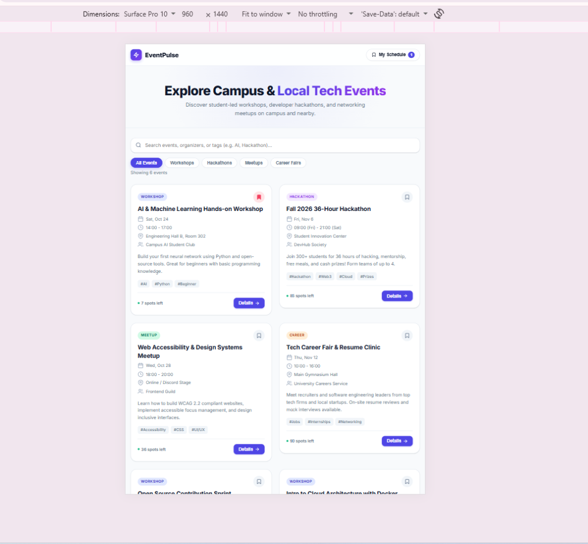
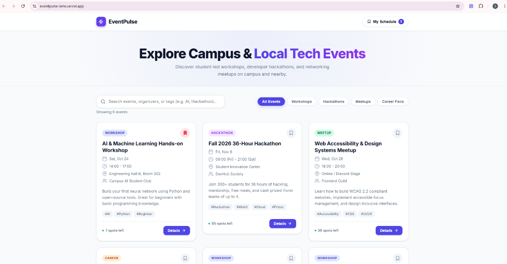

# EventPulse 🎓⚡

**A Campus and Local Technology Event Finder**

EventPulse is a responsive web application that helps students and young technology enthusiasts discover events, search for relevant opportunities, view event details, and bookmark events for later reference.

The project is being developed as part of **BuildLab Stage 1 — Frontend Development**.

## 1. Project Overview

### Problem Statement

Campus technology events, workshops, hackathons, and developer meetups are often announced through different social media platforms, group chats, and flyers. As a result, students may find it difficult to discover relevant opportunities and keep track of events they are interested in.

EventPulse aims to make event discovery and organization easier through a single, interactive interface.

### Target Users

- University and polytechnic students.
- Coding bootcamp participants.
- Junior software developers.
- People interested in technology workshops, hackathons, and meetups.

### Core User Flow

**Browse Events → Search or Filter → View Event Details → Bookmark Events → Revisit Saved Events**

## 2. Technology Stack

The current version uses standard browser technologies without a build tool.

| Technology            | Purpose                                                                 |
| --------------------- | ----------------------------------------------------------------------- |
| HTML5                 | Defines the structure and content of the application.                   |
| CSS3                  | Controls styling, responsive layouts, and visual presentation.          |
| JavaScript ES Modules | Handles interactions and organizes the application logic.               |
| LocalStorage          | Stores saved event IDs and the remembered email address in the browser. |
| CSS Grid and Flexbox  | Help arrange content across different screen sizes.                     |

### Why I Chose This Stack

I chose HTML5, CSS3, and vanilla JavaScript to build a lightweight application without requiring a frontend framework or bundler.

This approach allows me to practise semantic HTML, responsive design, DOM manipulation, event handling, JavaScript modules, and accessibility fundamentals.

## 3. Main Features

### Event Listing

Displays sample technology events with information such as event titles, categories, dates, locations, and organizers.

### Search

Allows users to search for events using supported event information, including titles, organizers, locations, and tags.

### Category Filtering

Allows users to narrow the event list by category.

### Event Details Modal

Provides additional information about a selected event in a modal.

The modal supports dismissal through its available close controls, backdrop clicks, and the Escape key. Keyboard focus trapping and focus restoration ensure that keyboard navigation remains contained and returns to the triggering button on close.

### Bookmarks and My Schedule

Users can bookmark events and access their saved events via an interactive slide-out drawer.

Saved event IDs are stored in LocalStorage so that bookmarks persist across page refreshes in the same browser.

### Email Reminder Interface

Users can open an email reminder form for an event with built-in email validation.

The current implementation prepares an email using the user's default email application through a `mailto:` link. It does not send emails directly from a server.

### Empty Results Feedback

The application provides feedback when a search or category filter produces no matching events and offers a way to reset the filters.

## 4. Project Structure

```text
EventPulse/
│
├── index.html
├── README.md
│
├── data/
│   └── events.json
│
├── docs/
│   ├── idea-one-pager.md
│   ├── work-plan.md
│   ├── issue-log.md
│   └── screenshots/
│
├── scripts/
│   ├── app.js
│   ├── utils.js
│   ├── icons.js
│   └── components/
│       ├── EventCard.js
│       ├── FilterBar.js
│       └── EventModal.js
│
└── styles/
    ├── main.css
    └── variables.css
```

### File Responsibilities

- `index.html`: Main HTML structure including loading skeleton, error state, and dialog templates.
- `styles/main.css`: Layout, component styles, skeleton animations, error state, and responsive breakpoints.
- `styles/variables.css`: Reusable CSS custom properties for colours, spacing, and typography.
- `scripts/app.js`: Application orchestrator — async data fetch, top-level state, and component wiring.
- `scripts/utils.js`: Shared helpers (`escapeHTML`, `formatDate`, `trapFocus`).
- `scripts/icons.js`: Reusable inline SVG icon strings.
- `scripts/components/EventCard.js`: Pure function that returns HTML for a single event card.
- `scripts/components/FilterBar.js`: Owns search input and category pill filter interactions.
- `scripts/components/EventModal.js`: Owns Event Detail modal open/close/populate/focus logic.
- `data/events.json`: Event data loaded asynchronously via `fetch()` on startup.
- `docs/idea-one-pager.md`: Project idea, target users, problem statement, scope, and risks.
- `docs/work-plan.md`: Three-week development plan and delivery milestones.
- `docs/issue-log.md`: Documented bugs and technical challenges with root causes and fixes.


## 5. How to Run Locally

EventPulse uses JavaScript ES Modules. For reliable local testing, run the application through a local HTTP server.

### Requirements

- A modern web browser.
- Python installed on your computer, or another local static web server.

No frontend build step is currently required.

### Steps

**Step 1:** Download or clone the project repository.

```bash
git clone https://github.com/samsonchibuikem54-max/BuildLab.git
```

**Step 2:** Open the project folder in your terminal.

```bash
cd BuildLab
```

**Step 3:** Start a local server using Python.

```bash
python -m http.server 8000
```

If your system uses the `python3` command instead, run:

```bash
python3 -m http.server 8000
```

Or using Node.js:

```bash
npx serve .
```

**Step 4:** Open this address in your browser:

```text
http://localhost:8000
```

If port 8000 is already being used, choose another available port.

## 6. Accessibility and Responsive Design

Accessibility and responsive design are important parts of EventPulse.

The implementation includes the following accessibility features:

- Semantic HTML elements (`<header>`, `<nav>`, `<main>`, `<section>`, `<article>`, `<button>`).
- A skip link for navigating to the main content.
- Explicit form control labels and live error feedback.
- Visible keyboard focus styling (`:focus-visible`).
- An ARIA live region for dynamic announcements.
- Keyboard focus trapping in dialogs and drawers with Escape key dismissal.
- Focus restoration returning focus to trigger elements upon modal close.

The layout uses CSS Grid, Flexbox, and mobile-first media queries to support different screen sizes from 320px to 4K displays.

## 7. Data and Storage

The current version uses locally defined sample event data.

Bookmarks are stored in the browser using LocalStorage. The email reminder interface also remembers the entered email address in LocalStorage.

This means that the application does not currently require a backend database or user authentication.

The sample event information is not automatically updated from a live events service.

## 8. Current Limitations

The current version has the following limitations:

- Event information is based on sample data.
- There is no live event API integration yet (planned for Week 2).
- Bookmarks are stored locally in the browser rather than in a cloud database.
- The email reminder feature relies on the user's default email application.
- There is no backend user authentication.
- Automated unit test suites have not yet been configured (planned for Week 3).

These limitations will guide further development during the BuildLab programme.

## 9. Three-Week Development Plan

| Week   | Focus                | Planned Deliverables                                                                                                |
| ------ | -------------------- | ------------------------------------------------------------------------------------------------------------------- |
| Week 1 | Foundations          | Idea one-pager, work plan, responsive interface, JavaScript interactions, README, and screenshots.                  |
| Week 2 | Components and Data  | Reusable components or modules, asynchronous JSON data integration, loading and error states, and issue log.        |
| Week 3 | Quality and Delivery | Multiple views, persistent state, accessibility improvements, automated tests, deployment, and final documentation. |

The implementation will be updated as each stage is completed.

## 10. Top Three Risks

### Risk 1: Accessibility Issues

Custom modals and interactive controls may not behave correctly for keyboard or screen-reader users.

**Mitigation:** Implement strict focus trapping, focus restoration, accessible names, screen-reader announcements, and maintain 4.5:1+ colour contrast.

### Risk 2: Responsive Layout Problems

Some elements may overflow or become difficult to use on small screens.

**Mitigation:** Test the layout at different viewport widths, starting at 320px, and correct any overflow or spacing problems using fluid grid and flexbox.

### Risk 3: Inconsistent Application State

Saved events may not remain consistent between event cards, the detail modal, and the saved-events view.

**Mitigation:** Keep the application state centralized in JavaScript and sync bookmarks with LocalStorage and custom event handlers.

## 11. Screenshots

Add screenshots showing the application at mobile and desktop widths.

Suggested folder structure:

```text
docs/
└── screenshots/
    ├── eventpulse-mobile.png
    └── eventpulse-desktop.png
```

After adding the screenshots, you can display them here:

### Mobile View


### Desktop View


## 12. Project Links

- **GitHub Repository:** [https://github.com/samsonchibuikem54-max/BuildLab](https://github.com/samsonchibuikem54-max/BuildLab)
- **Live Application (Vercel Root):** [https://eventpulse-lime.vercel.app/](https://eventpulse-lime.vercel.app/)
- **Task 1 (Live):** [https://eventpulse-lime.vercel.app/task-1/](https://eventpulse-lime.vercel.app/task-1/)
- **Task 2 (Live):** [https://eventpulse-lime.vercel.app/task-2/](https://eventpulse-lime.vercel.app/task-2/)
- **Task 2 (404 Page Live):** [https://eventpulse-lime.vercel.app/task-2/404.html](https://eventpulse-lime.vercel.app/task-2/404.html)
- **Task 3 (Live with Hash Router):** [https://eventpulse-lime.vercel.app/task-3/](https://eventpulse-lime.vercel.app/task-3/)
- **Task 3 (Automated Test Runner Live):** [https://eventpulse-lime.vercel.app/task-3/tests/test-runner.html](https://eventpulse-lime.vercel.app/task-3/tests/test-runner.html)
- **Task 3 (404 Page Live):** [https://eventpulse-lime.vercel.app/task-3/404.html](https://eventpulse-lime.vercel.app/task-3/404.html)
- **Idea One-Pager:** [docs/idea-one-pager.md](https://github.com/samsonchibuikem54-max/BuildLab/blob/main/docs/idea-one-pager.md)
- **Work Plan:** [docs/work-plan.md](https://github.com/samsonchibuikem54-max/BuildLab/blob/main/docs/work-plan.md)
- **Issue Log:** [docs/issue-log.md](https://github.com/samsonchibuikem54-max/BuildLab/blob/main/docs/issue-log.md)
- **Accessibility Audit:** [task-3/docs/accessibility-audit.md](https://github.com/samsonchibuikem54-max/BuildLab/blob/main/task-3/docs/accessibility-audit.md)


## 13. Development Notes

EventPulse is being developed incrementally throughout BuildLab Stage 1.

Changes, feedback, technical decisions, and outstanding issues will be documented as development continues.

AI tools were used to assist with parts of the development process, including semantic structure and accessibility-related implementation. The code and resulting behaviour will be reviewed and tested as the project progresses.

---

**Project:** EventPulse  
**Track:** Frontend Development  
**Programme:** BuildLab Stage 1
