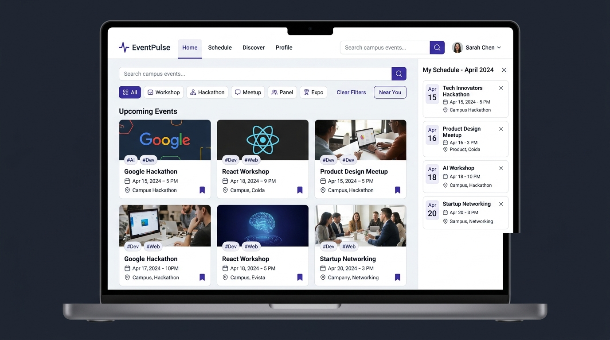

# EventPulse — UI/UX Design Specification & System

This document outlines the UI/UX design architecture, design tokens, component hierarchy, user journeys, and wireframe representations for the **EventPulse** project across all tasks.

---

## 1. Visual Mockup & Design Showcase



---

## 2. Design System & Design Tokens

### Color Palette

| Token | Hex / Value | Role & Usage | Contrast Ratio |
|---|---|---|---|
| `--color-primary` | `#4f46e5` (Indigo 600) | Primary brand color, hero gradient, call-to-action buttons | 4.9:1 against white |
| `--color-primary-hover` | `#4338ca` (Indigo 700) | Button hover & active states | 5.8:1 against white |
| `--color-primary-light` | `#eef2ff` (Indigo 50) | Pill background, badge tints, category indicators | Background accent |
| `--color-text-main` | `#0f172a` (Slate 900) | Headings, event titles, high-emphasis text | 16:1 against white |
| `--color-text-muted` | `#64748b` (Slate 500) | Subtitles, event metadata, date/time labels | 4.6:1 against white |
| `--color-bg-body` | `#f8fafc` (Slate 50) | Main background canvas | Base surface |
| `--color-bg-surface` | `#ffffff` (Pure White) | Card surfaces, modal surfaces, drawer container | Elevated surface |
| `--color-border` | `#e2e8f0` (Slate 200) | Card borders, dividers, search input outline | Subtle division |
| `--color-focus-ring` | `#6366f1` (Indigo 500) | `:focus-visible` accessibility focus indicator | High visibility |

### Typography Hierarchy

- **Font Family**: `'Inter', system-ui, -apple-system, sans-serif`
- **Scale**:
  - Hero Heading (`h1`): `clamp(1.75rem, 4vw, 2.75rem)` | Weight: `800` | Line-height: `1.2`
  - Modal / Section Heading (`h2`): `1.35rem` – `1.5rem` | Weight: `700`
  - Card Title (`h3`): `1.125rem` | Weight: `700` | Line-height: `1.35`
  - Body Text: `0.9375rem` – `1rem` | Weight: `400` / `500` | Line-height: `1.6`
  - Metadata / Badges / Tags: `0.75rem` – `0.85rem` | Weight: `600` | Letter-spacing: `0.02em`

### Spacing & Grid System

- **Container Max-Width**: `1200px` centered with responsive horizontal padding.
- **Breakpoints**:
  - Mobile: `< 640px` (1-column card stack, full-width search, horizontal scrolling filter pills)
  - Tablet: `640px – 1023px` (2-column card grid)
  - Desktop: `≥ 1024px` (3-column responsive grid, side-by-side search & category controls)

---

## 3. Core Component UX Specifications

### A. Navigation & Header
- **Brand Identity**: Lightning bolt SVG icon paired with high-contrast logotype.
- **Task Switcher**: Direct one-click access across all tasks (`Task 1`, `Task 2`, `Task 3`, `404`).
- **Schedule Pill**: Floating counter badge displaying the exact quantity of saved events with live updates.

### B. Search & Category Filters
- **Real-Time Input**: Search icon adornment, clear button support, and live polite screen-reader announcements on query matches.
- **Category Chips**: Quick-toggle filter pills (`All`, `Workshops`, `Hackathons`, `Meetups`, `Career Fairs`) with `aria-pressed` states.

### C. Event Cards
- **Category Badge**: Distinctive tinted tag at top left.
- **Bookmark Star / Toggle**: High-visibility interactive button with instant feedback toast notifications.
- **Metadata Stack**: Standardized SVG icons for Calendar, Clock, Location, and Organizer.
- **Live Capacity Indicator**: Pulsing badge displaying spots remaining or "Full" state.
- **Details Action**: Primary action opening the deep-linkable modal.

### D. Overlays (Modal & Schedule Drawer)
- **Focus Trap**: Traps keyboard navigation within the dialog until dismissed.
- **Restoration**: Focus returns directly to the triggering card button.
- **Dismissal Triggers**: Close icon button, dismiss button, Escape key, or backdrop click.

---

## 4. User Journey & Interaction Flow

```
[User Lands on Page]
        │
        ▼
[Browse Event Grid / View Skeleton Shimmer while Fetching]
        │
        ├─────────────────────────────┬─────────────────────────────┐
        ▼                             ▼                             ▼
[Type in Search Box]          [Click Category Pill]        [Click Bookmark Toggle]
        │                             │                             │
        ▼                             ▼                             ▼
[Filter Cards Dynamically]    [Isolate Category Cards]     [Save to LocalStorage]
        │                             │                             │
        └─────────────────────────────┼─────────────────────────────┘
                                      │
                                      ▼
                        [Click "Details" Button]
                                      │
                                      ▼
                    [Open Modal & Push Hash to URL: #/event/:id]
                                      │
                         ┌────────────┴────────────┐
                         ▼                         ▼
             [Read Prereqs & Details]      [Set Email Reminder]
                         │                         │
                         ▼                         ▼
             [Close Modal / Press Esc]    [Dispatch Pre-filled mailto:]
                         │
                         ▼
        [Focus Restored to Card / Route Returns to #/]
```
